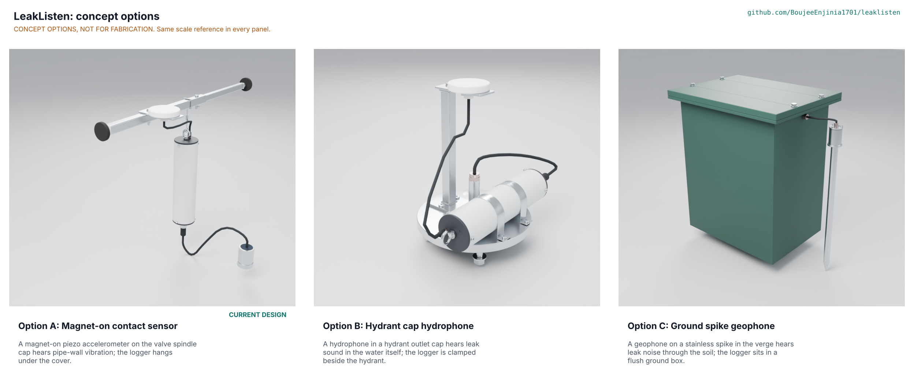

# LeakListen concept options

Result: option A, the magnet-on contact sensor (the existing design), scored 155, option B, the hydrant cap hydrophone, 127, and option C, the ground spike geophone, 123, out of 205. Option A leads option B by 18 %, outside the 10 % band, so one option is recommended: **option A, with option B kept as the separate variant for plastic mains**. This is **Proposed, awaiting Amish** (LKL-DDR-004); nothing has been chosen. All three options are modelled to detail level D3 in `cad/src/model.py` ("Detail every option", Amish, 2026-10-24). The picture below is redrawn from those models by the coordinator's Blender run (`media/options.png` is not in the repo yet; see `docs/REVIEW.md`). Method: STANDARDS section 21.

## The options

### Option A: magnet-on contact sensor

A sealed piezo accelerometer puck on a 42 mm pot magnet snaps onto the valve spindle cap and listens to the pipe wall's vibration through the valve; a 63 mm PVC logger hangs under the cover from a neck bar and sends a 24-byte summary a night by LoRaWAN. This is the existing design (LKL-PRC-001) and does not change. It is placed from the surface, touches no water and weighs 0.96 kg (logger, cable and sensor); it hears about 185 m of iron main but only a few metres of plastic main, and its radio is at risk under an iron cover. Needs from a partner: valve and cover types, cover loss measurement.

### Option B: hydrant cap hydrophone

A stainless blind cap bolts to a hydrant outlet and carries a piezoceramic tube hydrophone in the water column; the same logger lies along the cap in two clips, and a short mast carries the antenna to just under the hydrant cover. A hydrophone hears the leak noise as pressure in the water on any pipe material (commercial hydrophone loggers on hydrant caps are sold, see LKL-MKT-001), which is the answer to plastic mains (UR-002). It sits in drinking water (product approval, UR-012), needs a hydrant with an open valve to fill the barrel, weighs 6.0 kg in the model and its cap interface is an assumption: the model has a four-bolt flange, real outlets are mostly threaded (STM SB4). Needs from a partner: hydrant type, permission to open hydrants, a water approval route.

### Option C: ground spike geophone

A stainless spike driven 0.5 m into the verge carries a geophone that hears the ground-borne noise of a leak, with its cable running to the same logger standing in a flush HDPE ground box with the antenna under a plastic lid. It needs no access to the pipe or the chamber and the antenna is not under iron, but the leak is heard only a few metres from the spike (STM SC1), the box is a 15.3 kg dig, and ground noise (traffic, trees) is likely to be high. Needs from a partner: utility records of where services are, permission to dig.

## First-order numbers

Table 1. Options compared (D3 model figures from `cad/fidelity.json`).

| Quantity | Option A | Option B | Option C |
| --- | --- | --- | --- |
| Estimated parts cost (USD) | 142 (priced BOM, `bom/bom.csv`) | At least 106 from the shared priced lines (logger 97 and sensing proxy 9) plus the cap, gasket, bolts, mast and clips, unpriced (to assess) | At least 106 from the shared priced lines plus the box, lid, spike, plate and fasteners, unpriced (to assess) |
| Mass of the D3 model (kg) | 1.3 (0.96 for logger, cable and sensor) | 6.0 | 15.3 |
| Reach for the reference leak | About 185 m on iron, 4 m on PVC | 54 m on PVC at an assumed 0.1 Pa/rtHz background (none at 1 Pa/rtHz; 17 m at the lowest efficiency) | A few metres of main: +14 dB signal to noise at 3 m, -6 dB at 10 m |
| Energy or effort | 1.25 mAh a day, 10 years or more | Same logger | Same logger |
| Parts in the D3 model (with fasteners and welds) | 72 (24 fasteners) | 89 (40 fasteners, 8 welds) | 80 (38 fasteners) |
| STEM check | Open: 1 detail fixed (S3), no fails | Open: plausible rows SB1, SB3, SB4 | Open: plausible rows SC1, SC2, SC3 |

## Scoring

Table 2. Weighted scoring (weights: High UR 3, Medium 2, Low 1; scores 1 to 5). One criterion per user requirement in LKL-URS-001; cost, buildability, safety and maintenance are covered by UR-008, UR-015, UR-011 and UR-015.

| Criterion | Source | Weight | A | B | C | Reason |
| --- | --- | --- | --- | --- | --- | --- |
| Hears leaks before they surface | UR-001 | 3 | 3 | 4 | 1 | A hears about 185 m on iron (at risk); B hears the water column directly; C hears only a few metres from the main (STM SC1) |
| Works on plastic mains too | UR-002 | 2 | 1 | 4 | 2 | A hears 4 m on PVC; B 54 m on PVC at an assumed background; C couples through soil, any pipe, a few metres |
| Placed from the surface | UR-003 | 3 | 5 | 4 | 2 | A lowers a puck by pole; B bolts a cap on a surface hydrant outlet; C digs a 0.42 x 0.30 x 0.52 m hole near buried services |
| Quick to place | UR-004 | 2 | 4 | 3 | 1 | A 11 min estimate; B four M12 bolts and a 6 kg cap (not estimated); C a hole, a box and a spike |
| Reports by itself | UR-005 | 3 | 3 | 3 | 5 | A and B transmit from under iron covers (range at risk); C's antenna sits under a plastic lid in the verge |
| Survives the chamber | UR-006 | 3 | 4 | 3 | 3 | A is IP68 and floats; B sits on a cap under hydrant pressure and frost; C is buried in wet soil |
| Runs for years unattended | UR-007 | 3 | 4 | 4 | 4 | All three use the same logger electronics and cell (10 years on energy) |
| Affordable for a small utility | UR-008 | 3 | 3 | 2 | 2 | A USD 142 priced; B and C add a stainless cap or an HDPE box and a spike, unpriced (to assess), shared lines alone are USD 106 |
| Raw sound stays on the device | UR-009 | 3 | 5 | 4 | 4 | Same rule in all three; a hydrophone or geophone is a better microphone than a contact sensor |
| Open data and standard radio | UR-010 | 2 | 4 | 4 | 4 | Same radio and payload |
| Safe to handle | UR-011 | 3 | 3 | 2 | 3 | B: a cap on a pressurised hydrant is a hazard if opened; C: digging and a driven spike; A: magnet, cover lifting, lithium cell |
| Does not touch the water | UR-012 | 3 | 5 | 1 | 5 | B's hydrophone sits in drinking water and needs product approval |
| Few false alarms | UR-013 | 2 | 3 | 3 | 2 | C hears traffic and trees; B hears hydraulic transients; A is the quietest coupling but still hears pumps |
| Small and light | UR-014 | 2 | 5 | 3 | 1 | Model mass 1.3 / 6.0 / 15.3 kg |
| Open and repairable | UR-015 | 2 | 4 | 3 | 4 | B needs a machined 316 cap and potted hydrophone; A and C use stock sections and turned or moulded parts |
| Legal to place and to transmit | UR-016 | 2 | 4 | 3 | 4 | B needs drinking-water product approval; C needs consent to dig; A needs permission to place only |
| **Weighted total** | | | **155** | **127** | **123** | |

Weighted total = sum of score x weight over the 16 criteria (maximum 205). The scores are the author's judgement from the first-order numbers; they are not field data and the weights are the priorities in LKL-URS-001.

## Recommendation

**Option A**, because it is the only option that is light, cheap, placed from the surface without touching the water, and already worked through to a priced, buildable design (155 against 127 and 123). Its weaknesses are the two the TRL 3 calculations already found: a short reach on plastic mains and a radio link that closes only with a gateway within about 0.5 km under an iron cover. **Option B's best idea**, a hydrophone on a hydrant cap, is the answer to the first weakness and is kept as the plastic-main variant (PR-002) rather than grafted onto option A, since a hydrophone changes the sensing principle and the water-contact rules. Option C is the weakest: the leak is heard only a few metres away. If Amish prefers a single product for all pipe materials, option B has the stronger acoustics (SB1) but sits in the water, weighs six times more and has an unpriced cap.

Recorded as "Proposed, awaiting Amish" in the decisions register (LKL-DEC-001) and argued in LKL-DDR-004.
